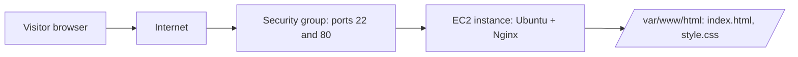

# Portfolio Website Deployed on AWS EC2

A responsive static portfolio website (HTML and CSS) hosted on an **Amazon EC2** Ubuntu server and served with **Nginx**. This was my first hands-on AWS project, built to learn how cloud servers, networking rules and web servers work together.

**Live demo:** `http://3.25.141.109/` *(the instance is stopped when not in use to save credits, so the link may be offline)*


---

## Architecture



| Component | Choice |
|---|---|
| Cloud provider | AWS (Free plan account) |
| Service | Amazon EC2 |
| Region | Asia Pacific (Sydney), `ap-southeast-2` |
| Instance type | `t3.micro` (free tier eligible) |
| Operating system | Ubuntu Server (LTS) |
| Web server | Nginx |
| Storage | 8 GiB volume |
| Frontend | HTML5, CSS3, inline SVG illustrations, a little vanilla JavaScript |
| Source control | Git and GitHub |

---

## EC2 deployment walkthrough

### 1. Launch the instance

In the EC2 console I chose **Launch instance** and used these settings:

- **Name:** `portfolio-server`
- **AMI:** Ubuntu Server (LTS), free tier eligible
- **Instance type:** `t3.micro`
- **Key pair:** RSA `.pem` key pair for SSH login (kept out of this repository)
- **Storage:** 8 GiB default volume

### 2. Configure the security group

A security group works as the instance's firewall. I opened only what the site needs:

| Type | Protocol | Port | Source | Purpose |
|---|---|---|---|---|
| SSH | TCP | 22 | Anywhere (key-based login only) | Administer the server |
| HTTP | TCP | 80 | Anywhere (0.0.0.0/0) | Public web traffic |


### 3. Confirm the instance is running

I waited for the state to show **Running** with **2/2 status checks passed**, then noted the public IPv4 address.


### 4. Connect to the server

I connected with **EC2 Instance Connect** from the AWS console (SSH with a key file also works):

```bash
ssh -i portfolio-key.pem ubuntu@YOUR_PUBLIC_IP
```

### 5. Install Nginx and Git

```bash
sudo apt update
sudo apt install -y nginx git
sudo systemctl enable --now nginx
```

Visiting `http://YOUR_PUBLIC_IP` showed the default "Welcome to nginx" page, which confirmed the server and port 80 were working.

### 6. Deploy the website

```bash
cd ~
git clone https://github.com/YOUR-USERNAME/my-portfolio.git
sudo cp ~/my-portfolio/index.html ~/my-portfolio/style.css /var/www/html/
sudo rm -f /var/www/html/index.nginx-debian.html
```

### 7. Verify

Opening `http://3.25.141.109/` now serves the portfolio (see the screenshot at the top of this page).

### Updating the site

```bash
# On my laptop
git add .
git commit -m "Update portfolio"
git push

# On the server
cd ~/my-portfolio && git pull
sudo cp index.html style.css /var/www/html/
```

---

## Problems I ran into and how I fixed them

| Problem | Cause | Fix |
|---|---|---|
| Used the wrong operating system commands | Amazon Linux was selected, but my commands were for Ubuntu | Switched the AMI to Ubuntu before launching |
| HTTP rule missing | The launch wizard only creates an SSH rule by default | Added an HTTP rule for port 80 |
| `git clone` asked for a password | The GitHub repository was private | Made the repository public |
| "Not secure" label in the browser | The site uses HTTP, not HTTPS | Understood the cause: HTTPS needs a domain and a certificate (listed under future improvements) |

---

## Cost and security notes

- Runs on the **AWS Free plan** using credits, with a free tier eligible instance.
- The instance is **stopped when not in use**. The public IP changes after a stop and start.
- The `.pem` key file is never committed (`.gitignore` blocks `*.pem`).
- Only ports 22 and 80 are open.
- Resources are terminated when the project is finished.

---

## What I learned

- How an EC2 instance is launched and configured (AMI, instance type, key pair, storage)
- How security groups control inbound traffic
- Connecting to a Linux server over SSH
- Installing and running Nginx and serving static files
- Deploying code from GitHub to a server
- Managing cloud costs by stopping and terminating resources

## Future improvements

- [ ] Attach an Elastic IP so the address stays the same
- [ ] Add a domain name and HTTPS with Let's Encrypt
- [ ] Automate setup with an EC2 user data script
- [ ] Auto-deploy with GitHub Actions on every push
- [ ] Compare with hosting on S3 and CloudFront

---

## Project structure

```
my-portfolio/
├── index.html
├── style.css
├── README.md
├── .gitignore
└── images/
    ├── 01-live-site.png
    ├── 02-security-group.png
    └── 03-instance-running.png
```

## Author

**Vedant Shelar** | [GitHub](https://github.com/VedantShelar7)